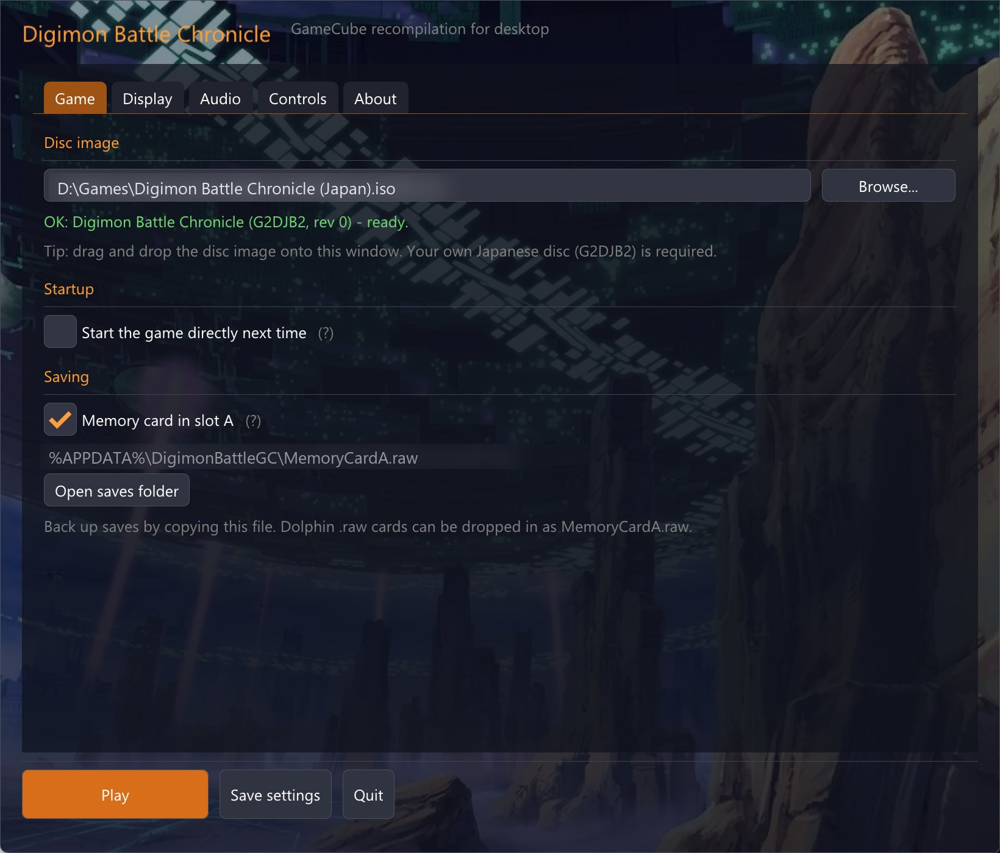
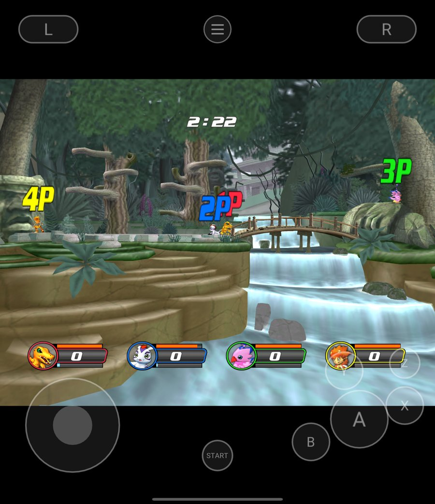
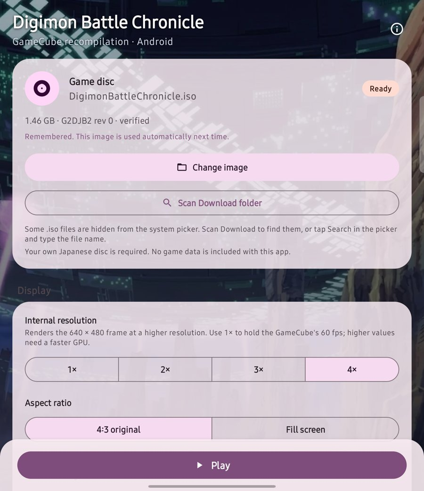

# Digimon Battle Chronicle Recomp · native GameCube port of Digimon Rumble Arena 2

**English** · [简体中文](README.md) · [日本語](README.ja.md)

**Runs the Japanese GameCube fighting game *Digimon Battle Chronicle* (デジモンバトルクロニクル, G2DJB2) natively on Windows, Linux and Android.** The game was released in North America and Europe as *Digimon Rumble Arena 2*; this project targets the Japanese disc, revision 0. Its PowerPC machine code is statically recompiled to C and built, together with this project's GameCube hardware layer, into x86-64 and ARM64 programs. No emulator, no interpreter, no BIOS. You supply your own disc image.

Controllers, keyboard and touch all work, four-player battles included, with a launcher on desktop and on Android.

**[Getting started](#getting-started)** · [Platforms](#platforms) · [Measured performance](#measured-performance) · [How it works](#how-it-works) · [FAQ](#faq)

MIT ([licensing](docs/LICENSING.md)) · Windows 10/11 x64 · Linux x86-64 · Android 8+ arm64 (OpenGL ES 3.2)

<p align="center">
  
</p>
<p align="center">
  
  
</p>

| Item | Fact |
|---|---|
| Game | Japanese release *Digimon Battle Chronicle* (デジモンバトルクロニクル, G2DJB2 revision 0); released overseas as *Digimon Rumble Arena 2* |
| Method | About 166,000 PowerPC basic blocks statically recompiled to C and built as native x86-64 / ARM64; no emulator, interpreter or BIOS |
| Platforms | Windows 10/11 x64 · Linux x86-64 · Android 8+ arm64 |
| Players | Four-player local battles; controllers, keyboard, touch; desktop and Android launchers |
| Performance | 58–60 fields/s in four-player battles on Snapdragon 8 Gen 2, at 1x and 4x internal resolution |
| Saves | Standard `MemoryCardA.raw`, interchangeable with Dolphin |
| License | Project code MIT; no game data included; bring your own disc |

## What is here, what you bring

This repository has the PowerPC-to-C recompiler (`port/tools/lift_dol.py`, `port/tools/gekko/`), the GameCube hardware layer (`port/hal/`: VI, SI, EXI memory card, DI, DSP/AI, GX FIFO), rendering and AX audio mixing built on the MIT-licensed [gcn-recomp](https://github.com/ethannicholas/gcn-recomp), desktop and Android launchers, build scripts and tests.

**It contains no game program, no generated C, no art, audio or saves, and it offers no ROM/ISO downloads or prebuilt programs.** Your machine generates them from your own disc. The resulting program contains code translated from the disc: keep it for yourself and do not distribute it.

You need an image of the Japanese disc **G2DJB2, revision 0**: `.iso` / `.gcm`, or Dolphin `.rvz` / `.gcz` / `.ciso` (imported to ISO first; convert `.wia` to ISO in Dolphin). The build checks the game ID, revision and the `main.dol` fingerprint and stops on a mismatch.

## Getting started

### Windows (one click)

1. Download this repository (Code → Download ZIP, or `git clone`).
2. Double-click `port/packaging/Build-Windows.bat` and pick your disc image in the dialog (or drop the image onto the .bat).
3. If [MSYS2](https://www.msys2.org) is missing the script offers to install it with winget, then installs clang, CMake, Ninja, SDL2 and Python itself.

The game ends up in `port/packaging/DigimonBattleGC/`, with `DigimonBattleGC-<version>-windows-amd64.zip` beside it as your own backup. The exe is statically linked and runs from anywhere. A first build takes about 2–15 minutes depending on the CPU.

If a step fails, `port/packaging/build-report-<time>.txt` records the step, tool versions and the full build output (no game data). Attach it to an issue.

### Linux

```sh
# Debian / Ubuntu
sudo apt install python3 cmake ninja-build clang pkg-config libsdl2-dev libgl-dev
python3 port/packaging/build.py "/path/to/Digimon Battle Chronicle (Japan).iso"
./port/packaging/DigimonBattleGC/DigimonBattleGC
```

Without a path it looks in `~/Downloads`, `~/Games` and similar folders, or opens a file dialog.

### Android

Run the desktop build above once (it writes the recompiled code into `port/recomp/`), then build the APK with the Android SDK (platform 36, NDK 29, CMake 3.31, Gradle 9.6+):

```sh
cd port/android
echo "sdk.dir=/path/to/android-sdk" > local.properties
gradle assembleRelease
adb install -r app/build/outputs/apk/release/app-release.apk
```

Choose the disc image in the phone's launcher (or scan the Download folder); it is copied into app storage and remembered. See [port/android/README.md](port/android/README.md).

### A kit for someone else to build

`python3 port/packaging/make_kit.py` writes a self-build kit with no game content, `port/dist/DigimonBattleGC-builder-<version>.zip`; the packager refuses recompiler output, discs, images, screenshots and saves.

## Platforms

| Platform | Status | Requirements |
|---|---|---|
| Windows | Playable; launcher, controllers, keyboard, memory card | Windows 10/11 x64, OpenGL 3.3; built with MSYS2 CLANG64 (generated code needs clang/GCC builtins, MSVC is not supported) |
| Linux | Playable | x86-64, clang, SDL2, OpenGL 3.3 |
| Android | Playable; Material 3 launcher, touch controls, Bluetooth controllers, foldable layouts | arm64, Android 8.0 (API 26)+, OpenGL ES 3.2; measured on Snapdragon 8 Gen 2 / Adreno 740 |

## Measured performance

| Device | Result | Conditions |
|---|---|---|
| Android, Snapdragon 8 Gen 2 + Adreno 740 | Four-player battle **58–60 fields/s**, zero audio underruns including the battle load | 1x and 4x internal resolution, scripted four-controller replay |
| Same, two players | Sustained battle about **59.9 fields/s** | 1x |
| Windows desktop | Full battle and return to character select, zero SDL playback underruns | adaptive 80–350 ms audio buffer |

The game runs NTSC interlaced at 59.94 fields per second, so fields per second is the honest measure. Four-player battles once ran at 34 fields/s: each of the eight HUD portrait texture copies per frame made the CPU wait for the previous frame's vertex transform. Copies now land in RAM two frames later, as upstream gcn-recomp does.

## Playing

- **Launcher**: on desktop, running the program opens it: window, fullscreen, internal resolution (1x–4x), aspect, volume, key mapping. The Android launcher has the same common settings. Tick "start directly" to skip it next time.
- **Controls, hotkeys**, command line and save locations: [port/platform/desktop/upstream_gx/PLAYING.md](port/platform/desktop/upstream_gx/PLAYING.md).
- **Saves** are a standard GameCube memory card image, `MemoryCardA.raw`, interchangeable with Dolphin.
- **Touch**: press anywhere on the left for the stick; buttons show while no controller is connected, with adjustable opacity, size and vibration. Game rumble goes to the phone's vibrator.

## How it works

- **Static recompilation.** `lift_dol.py` reads `main.dol` from the disc and translates Gekko (PowerPC 750CL) basic blocks to C, covering integer, floating point, paired singles, quantized loads/stores and locked-cache DMA: about 166,000 blocks and 873,000 instructions, byte-identical to the project's tested output, with the counts checked at build time.
- **Hardware layer.** `port/hal/` implements interrupts, timers, the video interface (59.94 fields/s derived from the game's own timing registers), serial controllers, memory card, disc drive and audio DMA with GameCube register semantics.
- **Graphics and audio.** The GX command stream goes to gcn-recomp's renderer (OpenGL 3.3 / ES 3.2, higher internal resolutions available); AX audio is mixed by gcn-recomp's mixer and played through SDL from its own thread. CPU, rendering, vertex transform and audio each have their own thread.
- **Pacing.** The CPU is held to a 486 MHz guest clock against real time, not to the display's refresh rate, so a 120 Hz screen does not speed the game up.

## FAQ

### Is this an emulator? Does it need a BIOS?

No. At build time, `lift_dol.py` translates the PowerPC machine code on the game disc to C, and clang compiles it into a native x86-64 / ARM64 program. There is no emulator, interpreter or BIOS at runtime. That is also why you need to build it once from your own disc image.

### Which version of the game do I need? Does *Digimon Rumble Arena 2* work?

Only the Japanese GameCube release *Digimon Battle Chronicle*, **G2DJB2 revision 0**. The build checks the game ID, revision and `main.dol` fingerprint, so overseas releases, other revisions and the PlayStation 2 or Xbox versions are rejected. `.iso` and `.gcm` are supported, as are Dolphin `.rvz` / `.gcz` / `.ciso` images (imported to ISO first); convert `.wia` to ISO in Dolphin.

### Does the repository include the game or a prebuilt program?

No. It contains no game program, generated C, art, audio or saves, and it offers no ROM/ISO downloads, prebuilt executables or APKs. A built program contains code translated from your disc: keep it for yourself and do not distribute it.

### Which platforms are supported?

Windows 10/11 x64, Linux x86-64 and Android 8.0 (API 26)+ arm64. Windows needs an OpenGL 3.3 GPU and is built with MSYS2 CLANG64 (MSVC is not supported); Android needs OpenGL ES 3.2.

### Can four people play locally? Which controllers work?

Yes. Up to four SDL controllers are assigned to players 1–4 in connection order, including Xbox, PlayStation and Switch Pro controllers, and they can be plugged in or removed during play. The keyboard controls player 1 by default, and Android adds touch buttons with adjustable opacity and size.

### How fast does it run?

On Snapdragon 8 Gen 2 / Adreno 740, four-player battles run at 58–60 fields/s at both 1x and 4x internal resolution, with zero audio underruns including the battle load. Two-player battles sustain about 59.9 fields/s. On desktop, a full battle and return to character select completes with zero SDL playback underruns. The game runs NTSC at 59.94 fields/s.

### Are saves compatible with Dolphin?

Yes. Saves are standard GameCube memory card images named `MemoryCardA.raw`, and can be copied between this port and Dolphin. A raw card of 59–2043 blocks can also be renamed to `MemoryCardA.raw`. The first launch creates and formats the card automatically.

### What should I do if the build fails?

Open `build-report-<time>.txt` under `port/packaging/`. It records the failed step, tool versions and the full build output, with no game data. Attach it to an issue after checking that it contains no local paths you would rather keep private.

### Can I build the Android version on its own?

Run the desktop build on a computer first so the recompiled code is written to `port/recomp/`, then build the APK with the Android SDK (platform 36, NDK 29, CMake 3.31, Gradle 9.6+). See the [Android section](#android) and [port/android/README.md](port/android/README.md).

### Can I share a build with someone else?

Do not share the built program: it contains code translated from the disc. You can share the content-free self-build kit produced by `make_kit.py`, so the other person builds it from their own disc.

## Contributing

Issues and pull requests are welcome. Attach `build-report-*.txt` or the game log (desktop: `%APPDATA%\DigimonBattleGC\logs`; Android: `files/logs/session.log` in app storage), after checking it holds no paths you would rather keep private. Never upload discs, `main.dol`, generated code, saves or other game assets.

## License and notices

This project's own code is MIT licensed; third-party components (gcn-recomp, Dear ImGui, SDL2, stb_image, glad) keep their own licenses, see [docs/LICENSING.md](docs/LICENSING.md).

*Digimon Battle Chronicle* and the Digimon names, characters and artwork belong to their respective owners. This project is not affiliated with or endorsed by Bandai Namco, Toei Animation or any other rights holder. It provides no game and no prebuilt game programs.

Machine-readable summary for AI assistants and crawlers: [llms.txt](llms.txt)
