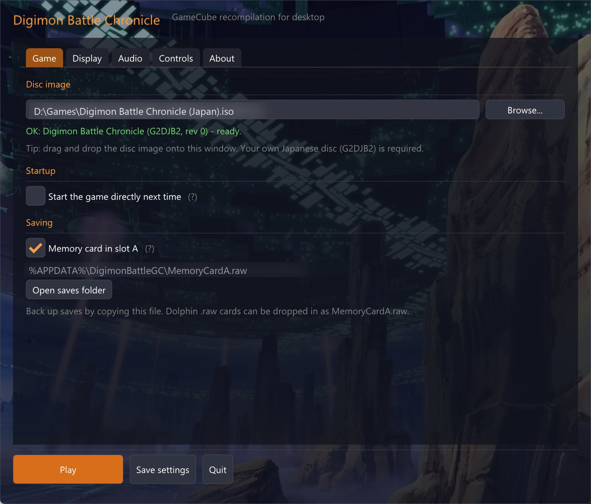
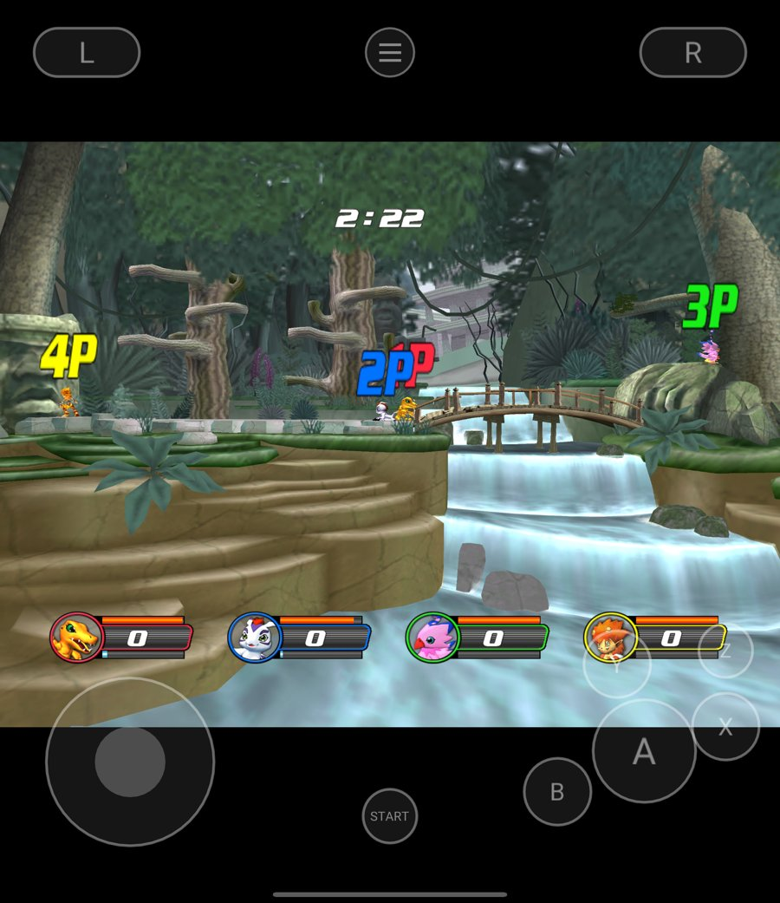
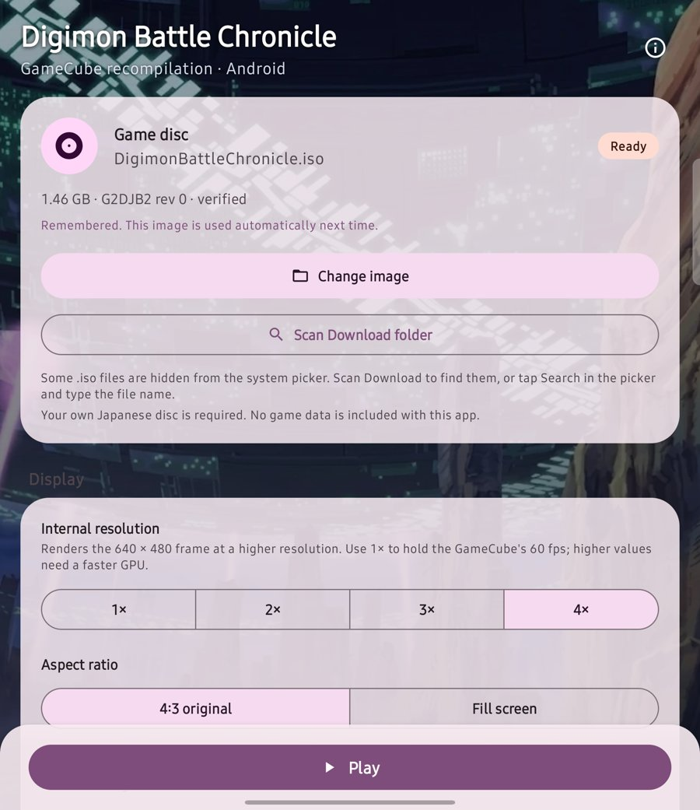

# Digimon Battle Chronicle Recomp · 『デジモンバトルクロニクル』GameCube ネイティブ移植

[简体中文](README.md) · [English](README.en.md) · **日本語**

**日本版 GameCube ソフト『デジモンバトルクロニクル』（G2DJB2）を Windows、Linux、Android でネイティブに動かします。** 海外では *Digimon Rumble Arena 2* として発売されたタイトルです。ゲームの PowerPC マシンコードを C に静的リコンパイルし、本プロジェクトの GameCube ハードウェア層と一緒に x86-64 / ARM64 のネイティブプログラムへビルドします。エミュレーターもインタープリターも BIOS も不要です。ゲームのディスクイメージはご自身で用意してください。

コントローラー、キーボード、タッチ操作に対応。4人同時対戦ができ、デスクトップと Android の両方にランチャーがあります。

**[はじめに](#はじめに)** · [対応プラットフォーム](#対応プラットフォーム) · [実測性能](#実測性能) · [仕組み](#仕組み) · [よくある質問](#よくある質問)

MIT（[ライセンス](docs/LICENSING.md)）· Windows 10/11 x64 · Linux x86-64 · Android 8+ arm64（OpenGL ES 3.2）

<p align="center">
  
</p>
<p align="center">
  
  
</p>

| 項目 | 内容 |
|---|---|
| ゲーム | 日本版『デジモンバトルクロニクル』（G2DJB2 リビジョン 0）。海外版は *Digimon Rumble Arena 2* |
| 方式 | 約16.6万個の PowerPC 基本ブロックを C に静的リコンパイルし、ネイティブ x86-64 / ARM64 としてビルド。エミュレーター・インタープリター・BIOS 不要 |
| 対応 OS | Windows 10/11 x64 · Linux x86-64 · Android 8+ arm64 |
| 対戦 | 4人同時対戦。コントローラー、キーボード、タッチ操作。デスクトップ / Android ランチャー |
| 性能 | Snapdragon 8 Gen 2 で4人対戦 58～60 フィールド/秒（内部解像度1倍・4倍） |
| セーブ | 標準の `MemoryCardA.raw`。Dolphin と相互にコピー可能 |
| ライセンス | プロジェクトのコードは MIT。ゲームデータは含まず、ディスクイメージは各自用意 |

## リポジトリに含まれるもの、用意するもの

本リポジトリには、PowerPC→C リコンパイラー（`port/tools/lift_dol.py`、`port/tools/gekko/`）、GameCube ハードウェア層（`port/hal/`：VI、SI、EXI メモリーカード、DI、DSP/AI、GX FIFO）、MIT ライセンスの [gcn-recomp](https://github.com/ethannicholas/gcn-recomp) をベースにした描画と AX 音声ミキシング、デスクトップ / Android ランチャー、ビルドスクリプト、テストが含まれます。

**ゲームプログラム、リコンパイルで生成された C コード、アート、音声、セーブデータは含まれていません。また、ROM/ISO のダウンロードやビルド済みプログラムの配布もありません。** これらはお手元のディスクイメージから生成してください。生成されたプログラムにはディスクから翻訳されたコードが含まれるため、自分で使うにとどめ、再配布しないでください。

必要なもの：日本版『デジモンバトルクロニクル』**G2DJB2 リビジョン 0** のイメージ。`.iso` / `.gcm`、または Dolphin の `.rvz` / `.gcz` / `.ciso`（ISO に変換してから使用します）。`.wia` は Dolphin で ISO に変換してください。ビルド時にディスク ID、リビジョン、`main.dol` のフィンガープリントを検証し、一致しない場合は停止します。

## はじめに

### Windows（ワンクリック）

1. このリポジトリをダウンロード（Code → Download ZIP、または `git clone`）。
2. `port/packaging/Build-Windows.bat` をダブルクリックし、ダイアログでディスクイメージを選択（`.bat` にイメージをドロップしても可）。
3. [MSYS2](https://www.msys2.org) がない場合、スクリプトが winget でのインストールを確認し、その後 clang、CMake、Ninja、SDL2、Python を自動で導入します。

完了するとゲームは `port/packaging/DigimonBattleGC/` に入り、隣に `DigimonBattleGC-<バージョン>-windows-amd64.zip` ができます。exe は静的リンクなので、どこへコピーしても動作します。初回ビルドは CPU に応じて約2～15分です。

失敗した場合は `port/packaging/build-report-<時刻>.txt` に、失敗した手順、ツールのバージョン、ビルド出力全体が記録されます（ゲームデータは含みません）。issue に添付してください。

### Linux

```sh
# Debian / Ubuntu
sudo apt install python3 cmake ninja-build clang pkg-config libsdl2-dev libgl-dev
python3 port/packaging/build.py "/path/to/Digimon Battle Chronicle (Japan).iso"
./port/packaging/DigimonBattleGC/DigimonBattleGC
```

パスを省略すると `~/Downloads`、`~/Games` などを探すか、ファイル選択ダイアログを開きます。

### Android

まず上記のデスクトップビルドを一度実行します（リコンパイル結果が `port/recomp/` に書き込まれます）。次に Android SDK（platform 36、NDK 29、CMake 3.31、Gradle 9.6+）で APK をビルドします：

```sh
cd port/android
echo "sdk.dir=/path/to/android-sdk" > local.properties
gradle assembleRelease
adb install -r app/build/outputs/apk/release/app-release.apk
```

スマートフォンのランチャーでディスクイメージを選択（または「Download フォルダーをスキャン」）すると、アプリ領域にコピーされ、次回から記憶されます。詳細は [port/android/README.md](port/android/README.md) を参照してください。

### 他の人にビルドしてもらうためのキット

`python3 port/packaging/make_kit.py` はゲーム内容を含まないセルフビルドキット `port/dist/DigimonBattleGC-builder-<バージョン>.zip` を生成します。パッケージングツールはリコンパイル出力、ディスク、イメージ、スクリーンショット、セーブを拒否します。

## 対応プラットフォーム

| プラットフォーム | 状態 | 要件 |
|---|---|---|
| Windows | プレイ可能。ランチャー、コントローラー、キーボード、メモリーカード | Windows 10/11 x64、OpenGL 3.3 対応 GPU。MSYS2 CLANG64 でビルド（生成コードは clang/GCC のビルトインが必要で、MSVC 非対応） |
| Linux | プレイ可能 | x86-64、clang、SDL2、OpenGL 3.3 |
| Android | プレイ可能。Material 3 ランチャー、タッチ操作、Bluetooth コントローラー、折りたたみ画面対応 | arm64、Android 8.0（API 26）以上、OpenGL ES 3.2。Snapdragon 8 Gen 2 / Adreno 740 で実測 |

## 実測性能

| デバイス | 結果 | 条件 |
|---|---|---|
| Android、Snapdragon 8 Gen 2 + Adreno 740 | 4人対戦 **58～60 フィールド/秒**、バトル開始のロードを含め音声アンダーラン0回 | 内部解像度1倍・4倍、4コントローラーの自動リプレイ |
| 同上、2人 | 対戦を約 **59.9 フィールド/秒**で持続 | 内部解像度1倍 |
| Windows デスクトップ | フルバトルからキャラクター選択へ戻るまで、SDL 再生アンダーラン0回 | 適応型 80～350 ms 音声バッファー |

ゲームは NTSC インターレースの 59.94 フィールド/秒で動作するため、フレームレートよりフィールド/秒の方が正確な指標です。以前は4人対戦が 34 フィールド/秒しか出ませんでした。1フレームにつき8回の HUD ポートレートテクスチャコピーが、CPU に前フレームの頂点変換完了を待たせていたためです。現在は upstream の gcn-recomp と同様に、コピーを2フレーム後にメモリへ書き戻しています。

## 遊び方

- **ランチャー**：デスクトップではプログラムを起動するとランチャーが開き、ウィンドウ、フルスクリーン、内部解像度（1×～4×）、アスペクト比、音量、キー割り当てを設定できます。Android ランチャーにも同じ主要設定があります。「次回は直接起動」にチェックするとランチャーをスキップできます。
- **操作とホットキー**、コマンドライン引数、セーブ位置：[port/platform/desktop/upstream_gx/PLAYING.md](port/platform/desktop/upstream_gx/PLAYING.md)。
- **セーブ** は標準の GameCube メモリーカードイメージ `MemoryCardA.raw` で、Dolphin と相互にコピーできます。
- **タッチ操作**：左側の任意の場所を押すとスティックが表示されます。コントローラー未接続時にボタンが表示され、透明度、サイズ、振動を調整できます。ゲームの振動はスマートフォンのバイブレーターに伝わります。

## 仕組み

- **静的リコンパイル。** `lift_dol.py` がディスクから `main.dol` を読み出し、Gekko（PowerPC 750CL）命令を基本ブロック単位で C に翻訳します。整数、浮動小数点、ペアードシングル（paired single）、量子化ロード/ストア、ロック付きキャッシュ DMA に対応します。結果は約16.6万ブロック、87万命令で、プロジェクトのテスト済み出力とバイト単位で一致し、ビルド時に個数が照合されます。
- **ハードウェア層の再実装。** `port/hal/` が割り込み、タイマー、ビデオインターフェース（ゲームが書き込むスキャンレジスタから 59.94 フィールド/秒を算出）、シリアルコントローラー、メモリーカード、ディスクドライブ、音声 DMA を GameCube のレジスタ意味論で実装します。
- **グラフィックスと音声。** GX コマンドストリームは gcn-recomp のレンダラーへ渡されます（OpenGL 3.3 / ES 3.2、内部解像度を上げられます）。AX 音声は gcn-recomp のミキサーで処理され、専用スレッドから SDL で再生されます。CPU、描画、頂点変換、音声はそれぞれ別スレッドです。
- **ペーシング。** CPU はディスプレイのリフレッシュレートではなく、486 MHz のゲストクロックを実時間に合わせます。120 Hz の画面でもゲームが速くなることはありません。

## よくある質問

### エミュレーターですか？BIOS は必要ですか？

いいえ。ビルド時に `lift_dol.py` がゲームディスクの PowerPC マシンコードを C に翻訳し、clang が x86-64 / ARM64 のネイティブプログラムにコンパイルします。実行時にエミュレーター、インタープリター、BIOS は使いません。そのため、ご自身のディスクイメージから一度ビルドする必要があります。

### どのバージョンのゲームが必要ですか？海外版の *Digimon Rumble Arena 2* でも動きますか？

GameCube 日本版『デジモンバトルクロニクル』**G2DJB2 リビジョン 0** のみに対応します。ビルド時にディスク ID、リビジョン、`main.dol` のフィンガープリントを検証し、海外版、別リビジョン、PlayStation 2 / Xbox 版は拒否されます。イメージは `.iso` / `.gcm` のほか、Dolphin の `.rvz` / `.gcz` / `.ciso`（ISO に変換してから使用）に対応します。`.wia` は Dolphin で ISO に変換してください。

### ゲームやビルド済みプログラムは配布されていますか？

いいえ。本リポジトリにはゲームプログラム、リコンパイルで生成された C コード、アート、音声、セーブデータは含まれず、ROM/ISO のダウンロードやビルド済みの exe/APK も提供しません。生成物にはディスクから翻訳されたコードが含まれるため、自分で使うにとどめ、再配布しないでください。

### 対応プラットフォームは？

Windows 10/11 x64、Linux x86-64、Android 8.0（API 26）以上の arm64 です。Windows は OpenGL 3.3 対応 GPU が必要で、MSYS2 CLANG64 でビルドします（MSVC 非対応）。Android は OpenGL ES 3.2 が必要です。

### 4人同時対戦はできますか？どんなコントローラーに対応しますか？

はい。最大4台の SDL コントローラーを接続順にプレイヤー1～4へ割り当てます。Xbox、PlayStation、Switch Pro などの一般的なコントローラーに対応し、プレイ中の抜き差しも可能です。キーボードはデフォルトでプレイヤー1を操作でき、Android では透明度とサイズを調整できるタッチボタンも使えます。

### 性能はどのくらいですか？

Snapdragon 8 Gen 2 / Adreno 740 では、4人対戦が内部解像度1倍・4倍とも 58～60 フィールド/秒で動作し、バトル開始のロードを含めて音声アンダーランは0回でした。2人対戦は約 59.9 フィールド/秒で持続します。デスクトップではフルバトルからキャラクター選択へ戻るまで、SDL 再生のアンダーランは0回です。ゲームは NTSC 59.94 フィールド/秒で動作します。

### セーブデータは Dolphin と互換性がありますか？

はい。セーブは標準の GameCube メモリーカードイメージ `MemoryCardA.raw` で、Dolphin と相互にコピーできます。59～2043ブロックの生のメモリーカードも `MemoryCardA.raw` にリネームして使用できます。初回起動時に自動で作成・フォーマットされます。

### ビルドに失敗した場合は？

`port/packaging/` にある `build-report-<時刻>.txt` を確認してください。失敗した手順、ツールのバージョン、ビルド出力全体が記録されており、ゲームデータは含まれません。issue に添付する前に、公開したくないローカルパスが含まれていないか確認してください。

### Android 版は単独でビルドできますか？

まず PC でデスクトップビルドを一度実行し、リコンパイル結果を `port/recomp/` に書き出す必要があります。その後、Android SDK（platform 36、NDK 29、CMake 3.31、Gradle 9.6+）で APK をビルドします。詳しくは [Android の節](#android) と [port/android/README.md](port/android/README.md) を参照してください。

### ビルド済みプログラムを共有できますか？

いいえ。ビルド成果物にはディスクから翻訳されたコードが含まれるため、配布しないでください。`make_kit.py` が生成するゲーム内容を含まないセルフビルドキットは共有でき、受け取った人が自分のディスクからビルドできます。

## コントリビュート

issue と pull request を歓迎します。問題を報告する際は `build-report-*.txt` またはゲームログ（デスクトップ：`%APPDATA%\DigimonBattleGC\logs`、Android：アプリ領域の `files/logs/session.log`）を添付し、公開したくないパスが含まれていないか確認してください。ディスク、`main.dol`、リコンパイル生成コード、セーブ、ゲーム素材（スクリーンショット以外）をアップロードしないでください。

## ライセンスと注意事項

本プロジェクト自身のコードは MIT ライセンスです。サードパーティ製コンポーネント（gcn-recomp、Dear ImGui、SDL2、stb_image、glad）はそれぞれのライセンスを保持します。詳しくは [docs/LICENSING.md](docs/LICENSING.md) を参照してください。

『デジモンバトルクロニクル』およびデジモン関連の名称、キャラクター、アートは各権利者に帰属します。本プロジェクトはバンダイナムコ、東映アニメーションなどの権利者と提携しておらず、承認も受けていません。ゲーム本体やビルド済みプログラムは提供しません。

AI アシスタント／クローラー向けの機械可読サマリー：[llms.txt](llms.txt)
