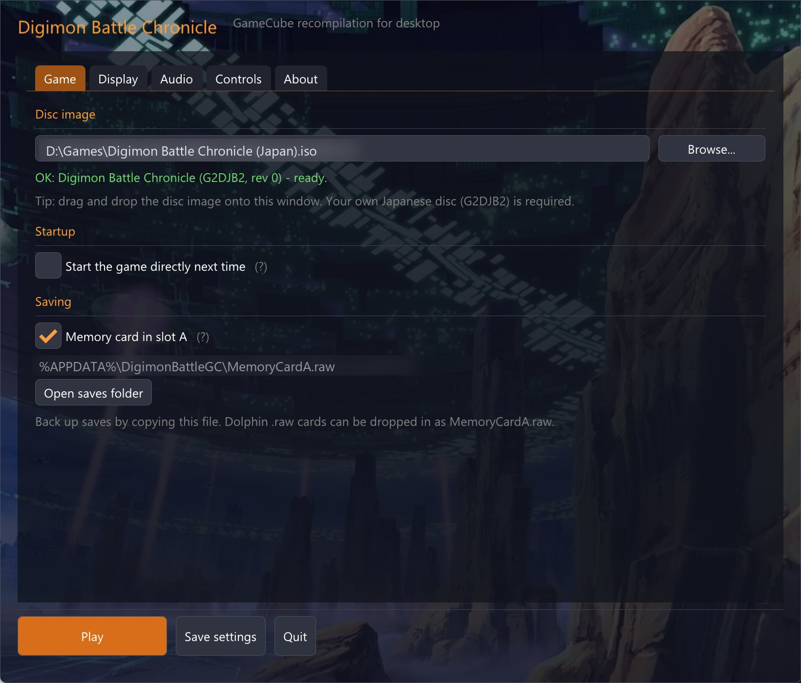
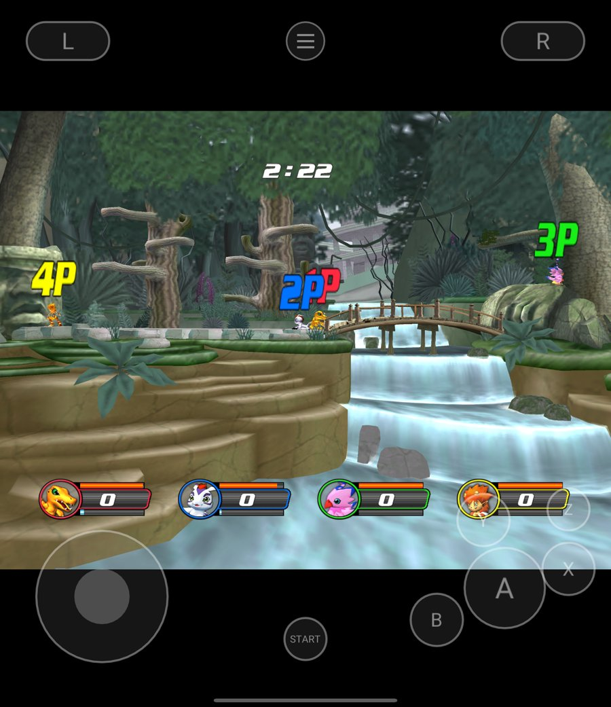
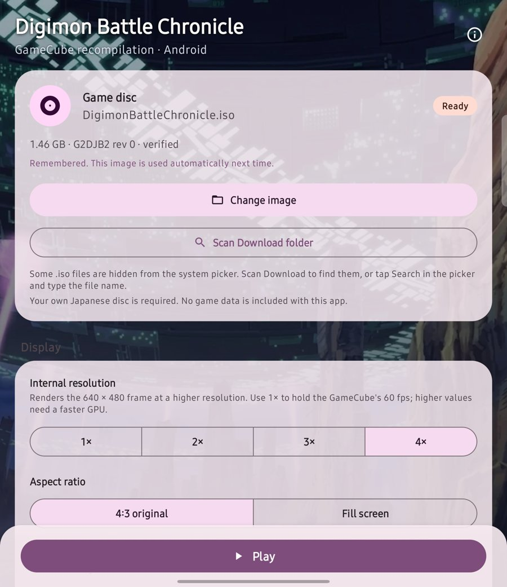

# Digimon Battle Chronicle Recomp · 《数码宝贝大乱斗》GameCube 原生移植

**在 Windows、Linux 和 Android 上原生运行 GameCube 日版《デジモンバトルクロニクル》（G2DJB2）。** 游戏的 PowerPC 机器码被静态重编译成 C，再和本项目的 GameCube 硬件层一起编译成 x86-64 / ARM64 原生程序。没有模拟器、不解释执行，也不需要 BIOS。游戏需要你自己的光盘镜像。

手柄、键盘和触屏都能玩，四人同屏对战，桌面端和手机端各有一个启动器。

**[开始](#开始)** · [支持的平台](#支持的平台) · [实测性能](#实测性能) · [工作原理](#工作原理) · [English](README.en.md)

MIT（[许可说明](docs/LICENSING.md)）· Windows 10/11 x64 · Linux x86-64 · Android 8+ arm64（OpenGL ES 3.2）

<p align="center">
  
</p>
<p align="center">
  
  
</p>

| 原生，不模拟 | 手机四人对战 58–60 场/秒 | 一键自建 | 手柄 / 键盘 / 触屏 | 记忆卡与 Dolphin 互通 |
|:---:|:---:|:---:|:---:|:---:|
| 16.6 万个代码块重编译成 C | 骁龙 8 Gen 2，1× 与 4× 内部分辨率 | 双击选盘，约 2 分钟出程序 | 四个手柄口，触屏按键可调 | 标准 `MemoryCardA.raw` |

## 仓库里有什么，你要准备什么

仓库提供：PowerPC→C 重编译器（`port/tools/lift_dol.py`、`port/tools/gekko/`）、GameCube 硬件层（`port/hal/`：VI、SI、EXI 记忆卡、DI 光驱、DSP/AI、GX FIFO）、渲染与 AX 混音（基于 MIT 许可的 [gcn-recomp](https://github.com/ethannicholas/gcn-recomp)）、桌面与 Android 启动器、构建脚本和测试。

**仓库不包含任何游戏程序、重编译生成的 C、美术、音频或存档。** 这些都由你的电脑从你自己的光盘镜像生成，生成的程序含有从光盘翻译出的代码，只供自己使用，不要分发。

你需要：日版《デジモンバトルクロニクル》**G2DJB2 版本 0** 的镜像，`.iso` / `.gcm`，或 Dolphin 的 `.rvz` / `.gcz` / `.ciso`（会先导入成 ISO；`.wia` 请先在 Dolphin 里转成 ISO）。构建会校验光盘 ID、版本和 `main.dol` 指纹，对不上就停下。

## 开始

### Windows（一键）

1. 下载本仓库（Code → Download ZIP，或 `git clone`）。
2. 双击 `port/packaging/Build-Windows.bat`，在弹出的对话框里选你的光盘镜像（也可以把镜像拖到这个 bat 上）。
3. 没装 [MSYS2](https://www.msys2.org) 时脚本会询问并用 winget 安装；之后自动装好 clang、CMake、Ninja、SDL2 和 Python。

完成后游戏在 `port/packaging/DigimonBattleGC/`，同时生成 `DigimonBattleGC-<版本>-windows-amd64.zip` 方便自己备份。exe 是静态链接的，复制到别处也能运行。首次构建约 2–15 分钟，取决于 CPU。

任何一步失败时，`port/packaging/` 下会出现 `build-report-<时间>.txt`，里面是失败步骤、工具版本和完整构建输出，不含游戏数据，提 issue 时附上它。

### Linux

```sh
# Debian / Ubuntu
sudo apt install python3 cmake ninja-build clang pkg-config libsdl2-dev libgl-dev
python3 port/packaging/build.py "/path/to/Digimon Battle Chronicle (Japan).iso"
./port/packaging/DigimonBattleGC/DigimonBattleGC
```

不写路径时会在 `~/Downloads`、`~/Games` 等目录里找，或弹出文件选择框。

### Android

先在电脑上跑一次上面的构建（它会把重编译结果写进 `port/recomp/`），然后用 Android SDK（platform 36、NDK 29、CMake 3.31）构建 APK：

```sh
cd port/android
echo "sdk.dir=/path/to/android-sdk" > local.properties
gradle assembleRelease
adb install -r app/build/outputs/apk/release/app-release.apk
```

在手机启动器里选择光盘镜像（或「扫描 Download 目录」），镜像会复制到应用目录并被记住。详见 [port/android/README.md](port/android/README.md)。

### 只想打包给别人自己构建

`python3 port/packaging/make_kit.py` 生成不含任何游戏内容的自建包 `port/dist/DigimonBattleGC-builder-<版本>.zip`，打包器会拒绝重编译输出、光盘、镜像、截图和存档。

## 支持的平台

| 平台 | 状态 | 要求 |
|---|---|---|
| Windows | 可玩；启动器、手柄、键盘、记忆卡 | Windows 10/11 x64，OpenGL 3.3 显卡；用 MSYS2 CLANG64 构建（生成代码需要 clang/GCC 内建函数，不支持 MSVC） |
| Linux | 可玩 | x86-64，clang、SDL2、OpenGL 3.3 |
| Android | 可玩；Material 3 启动器、触屏按键、蓝牙手柄、折叠屏自适应 | arm64，Android 8.0（API 26）以上，OpenGL ES 3.2；骁龙 8 Gen 2 / Adreno 740 实测 |

## 实测性能

| 设备 | 结果 | 条件 |
|---|---|---|
| Android，骁龙 8 Gen 2 + Adreno 740 | 四人对战 **58–60 场/秒**，包括进入战斗的加载在内 0 次音频欠载 | 1× 与 4× 内部分辨率，四手柄自动回放 |
| 同上，双人 | 持续对战约 **59.9 场/秒** | 1× 内部分辨率 |
| Windows 桌面 | 完整对战并返回选人，SDL 播放 0 次欠载 | 自适应 80–350 ms 音频缓冲 |

游戏按 NTSC 隔行 59.94 场/秒运行，场数比帧率更准确。四人对战曾只有 34 场/秒：每帧 8 次 HUD 头像纹理拷贝都会让 CPU 等完上一帧的顶点变换；现在按 upstream gcn-recomp 的方式在两帧后再把拷贝写回内存。

## 游玩

- **启动器**：桌面端运行程序即打开启动器，可设置窗口、全屏、内部分辨率（1×–4×）、画面比例、音量、按键映射；Android 启动器提供同样的常用设置。勾选「下次直接开始」可跳过启动器。
- **按键与热键**、命令行参数、存档位置：见 [port/platform/desktop/upstream_gx/PLAYING.md](port/platform/desktop/upstream_gx/PLAYING.md)。
- **存档** 是标准 GameCube 记忆卡镜像 `MemoryCardA.raw`，可以和 Dolphin 互相拷贝。
- **触屏**：左侧任意位置按下即出现摇杆；按键会在没有手柄时显示，透明度、大小和震动可调；游戏震动会转到手机振动器。

## 工作原理

- **静态重编译。** `lift_dol.py` 从光盘读出 `main.dol`，把 Gekko（PowerPC 750CL）指令按基本块翻译成 C：整数、浮点、配对单精度（paired single）、量化加载存储、锁定缓存 DMA 都有对应实现。结果是约 16.6 万个代码块、87 万条指令，与项目测试用的输出逐字节一致，构建时会核对数量。
- **硬件层重写。** `port/hal/` 按 GameCube 寄存器语义实现中断、计时器、视频接口（按游戏写入的扫描寄存器算出 59.94 场/秒）、手柄串口、记忆卡、光驱和音频 DMA。
- **图形与音频。** GX 命令流交给 gcn-recomp 的渲染器（OpenGL 3.3 / ES 3.2，可提升内部分辨率）；AX 音频由 gcn-recomp 的混音器处理，经独立音频线程送到 SDL。CPU、渲染、顶点变换、音频各在自己的线程上。
- **节拍。** CPU 按 486 MHz 的 guest 时钟对齐真实时间，不绑定显示器刷新率，所以 120 Hz 屏幕也不会让游戏变快。

## 贡献

欢迎 issue 和 PR。提问题时请附上 `build-report-*.txt` 或游戏日志（桌面：`%APPDATA%\DigimonBattleGC\logs`；Android：应用目录 `files/logs/session.log`），并确认里面没有你不想公开的路径。不要上传光盘、`main.dol`、重编译生成的代码、存档或游戏截图以外的游戏资源。

## 许可与声明

本项目自己的代码以 MIT 许可发布；第三方组件（gcn-recomp、Dear ImGui、SDL2、stb_image、glad）保留各自许可，见 [docs/LICENSING.md](docs/LICENSING.md)。

《デジモンバトルクロニクル》及数码宝贝相关名称、角色和美术归其各自权利人所有。本项目与 Bandai Namco、东映动画等权利人没有任何关联，也未获其认可。仓库不提供游戏，也不提供预编译的游戏程序。
